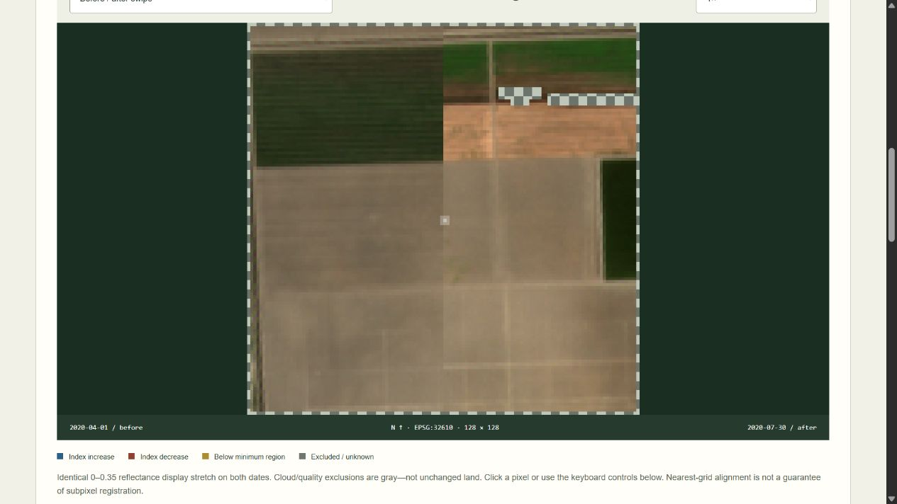

# Earth Observation Change Studio

**Notice the change. Question the cause.** An offline environmental imagery review application by [Jason Stys](https://github.com/JasonStys).

FIELDNOTE compares two dates on one geospatial grid, masks poor-quality pixels, calculates NDVI or green/NIR NDWI differences, and extracts connected candidate regions for human review. **Python, NumPy and Rasterio/GDAL** handle array computation, GeoTIFFs, alignment and geometry. **TypeScript, HTML, CSS and Canvas** present real raster evidence in a responsive browser. **SQL/SQLite** provides optional immutable local evidence history.

The repository includes two small, attributed **public Sentinel-2 observations** of Central Valley agricultural land and seven **synthetic known-answer cases**. It never presents a spectral threshold as a confirmed flood, damage or vegetation-loss label. Seasonal crop management, illumination, atmosphere, residual clouds and registration error can explain differences. No operational surveillance, targeting, private imagery collection, remote accounts or telemetry is included.



## What works

- Compare April and July 2020 public imagery offline, with original STAC metadata, exact crop hashes and pinned radiometric conversion retained.
- Align the second date to the first WGS84 UTM metre grid. Use nearest neighbour for reflectance, coverage and categorical quality data; do not blend cloud classes or silently assume equal array positions mean equal geography.
- Compute NDVI `(NIR-red)/(NIR+red)` or **green/NIR** NDWI `(green-NIR)/(green+NIR)`. Reject small denominators, invalid reflectance, nodata and unsupported quality classes.
- Apply explicit quality margins, thresholds and four-connected same-direction minimum-region filters. **Excluded is not unchanged**; no comparable pixels produces unavailable rates, not a misleading zero-change percentage.
- Verify every ratio and raw classification against an independently structured scalar implementation. Audit disjoint pixel accounting and retained-region membership.
- Explore before/after swipe, individual dates, candidate overlay, zoom, exact pixel coordinates/indices and quality breakdown. View threshold sensitivity without calling it statistical confidence.
- Review candidate regions in tab-local memory and download review JSON bound to the exact report identity. No automatic acceptance, server-side review storage or ground-truth claim.
- Export full JSON, dimensioned pixel CSV, inert HTML, actual **GeoTIFF** class/region rasters and **WGS84 GeoJSON** candidate footprints. Optionally retain hash-verified evidence in local SQLite.
- Exercise all **864 finite control combinations**, analytical grid/ratio/region oracles, generated spectra, actual browser workflows and cross-platform portable apps.

## Download a portable app

Open [Releases](https://github.com/JasonStys/earth-observation-change-studio/releases/latest). Download the ZIP for Windows x64, Linux x64 or macOS Apple Silicon and its matching `.sha256` file. Verify the digest; extract the **entire** `EarthObservationStudio` folder, including `_internal` and licenses.

- Windows: open `EarthObservationStudio.exe`.
- Linux/macOS: run `./EarthObservationStudio`. Linux ZIP extraction may require `chmod +x EarthObservationStudio`.

The application opens your normal browser on an ephemeral `127.0.0.1` port. Keep its console open; Ctrl+C stops it. No Python/Node installation, account, administrator access or internet connection is required for a bundle. These are **unsigned/unnotarized portable desktop applications**, not mobile installers or a public hosted multiuser service. Follow OS policy; do not bypass security warnings.

## Source setup

Requires Python **3.12–3.14**, Node **24** and supported prebuilt Rasterio/NumPy wheels. No Docker, external account or database server is needed.

```powershell
python -m venv .venv
.venv/Scripts/python -m pip install --require-hashes -r requirements-dev.lock
npm ci
npm run build
.venv/Scripts/python -m eostudio serve
```

Use `.venv/bin/python` on Linux/macOS. In a restricted execution environment, select a task-owned writable TEMP/TMP directory for development tests rather than changing OS protections. Production packages use the locked geospatial native wheels, not a pretend pure-Python TIFF parser.

## Export or use your own supported local pair

```powershell
.venv/Scripts/python -m eostudio export --scenario vegetation-loss --format geojson --output candidates.geojson
.venv/Scripts/python -m eostudio export --input eostudio/resources/sentinel/central-valley.json --format tif --output classes.tif --history private.sqlite3
```

Existing export files are never overwritten. [Input/API documentation](docs/API.md) defines the deliberately narrow manifest and five-band float32 GeoTIFF contract. Inputs must be local, bounded, chronological and hash-matched; arbitrary remote URLs, scripts, unconstrained rasters and browser uploads are not supported. Review third-party local TIFFs before processing them: this is **not a malicious-file sandbox**.

SQLite is optional, local and **unencrypted**. Hash checks and immutable-record triggers do not protect it from an OS user with file access. It caps at 100 distinct reports without automatic pruning; entry-count limits are not a tiny byte-size guarantee. Exported review notes remain user-owned local files. Do not commit private histories, input imagery, notes or credentials.

## Tests and reproducibility

```powershell
.venv/Scripts/python -m ruff check eostudio tests tools launcher.py
.venv/Scripts/python -m ruff format --check eostudio tests tools launcher.py
.venv/Scripts/python -m mypy eostudio
.venv/Scripts/python tools/verify_repo.py
.venv/Scripts/python -m pytest --cov=eostudio --cov-report=term-missing
.venv/Scripts/python -m tools.benchmark
npm run format:check
npm test
npm run build
npx playwright install chromium firefox webkit
npm run test:e2e
.venv/Scripts/python tools/package_app.py
```

Tests use checked-in crops and synthetic data, **not live satellite endpoints**. Benchmarks compare reviewed case summaries with declared numerical tolerances; report hashes identify quantized content, not a universal cross-GDAL/compiler identity. See [executed results and validation strategy](docs/VALIDATION.md). Dependency audits and CodeQL supplement—not replace—security review.

Actions workflows upload **no Actions artifacts or caches**. Releases are manually dispatched and exact-commit gated, built/smoke-tested on three operating systems, uploaded directly to a draft release, then independently download-verified before publication. No old run, artifact, cache or user data is deleted automatically.

## File and feature map

| Path                                               | Responsibility                                                                                              |
| -------------------------------------------------- | ----------------------------------------------------------------------------------------------------------- |
| `eostudio/raster.py`                               | Bounded local GeoTIFF contracts, UTM grids and nearest-neighbour alignment                                  |
| `eostudio/model.py`                                | Strict manifest/control schemas, source hashes/dates and synthetic fixtures                                 |
| `eostudio/engine.py`, `reference.py`               | Vectorized indices, scalar oracle, quality margins, connected regions, accounting and evidence identity     |
| `eostudio/reports.py`, `resources/history.sql`     | GeoJSON/GeoTIFF/CSV/HTML exports and optional immutable SQLite history                                      |
| `eostudio/server.py`, `__main__.py`, `launcher.py` | Protected read-only loopback service, explicit CLI and portable launcher                                    |
| `eostudio/resources/sentinel/`                     | Attributed public crops, original STAC responses and acquisition provenance                                 |
| `web/`                                             | Typed defensive UI, actual raster rendering, pixel inspection and human review                              |
| `tests/`                                           | Analytical/property/schema/geospatial/HTTP/SQL/CLI and three-browser regressions                            |
| `tools/`                                           | Explicit public-data acquisition, benchmarks, exact-line inventory, packaging/smoke and draft release gates |
| `.github/workflows/`                               | Pinned least-privilege cross-platform Validation, CodeQL and manual release workflows                       |
| `docs/`, `licenses/`                               | Scientific model, user/API/data guides, validation evidence, screenshots and notices                        |

Every code file has a creator/responsibility header; functions/classes have contracts. [CODE_INDEX](docs/CODE_INDEX.md) provides generated exact definition/variable line locations without fragile duplicated numbers in comments. [FILE_CATALOG](docs/FILE_CATALOG.md) summarizes every source-intent file. CI rejects stale inventories.

## Documentation and contact

[Architecture](docs/ARCHITECTURE.md) · [Scientific model](docs/MODEL.md) · [Data/provenance](docs/DATA.md) · [Input/API](docs/API.md) · [User guide](docs/USER_GUIDE.md) · [Validation](docs/VALIDATION.md) · [Release runbook](docs/RELEASE.md) · [Security](SECURITY.md) · [Notices](docs/THIRD_PARTY.md)

Created by **Jason Stys**. [Portfolio/contact](https://github.com/JasonStys) · [Help/issues](https://github.com/JasonStys/earth-observation-change-studio/issues). MIT project source; public Sentinel data retains its own terms and attribution. **Contains modified Copernicus Sentinel data (2020)**. No agency, provider, employer or mission endorsement is implied.

Contribute with a small synthetic reproduction, an independent expected answer, a regression test and updated documentation/inventory. New environmental-accuracy claims need appropriate labeled observations and independent evaluation, not just a refreshed snapshot.
